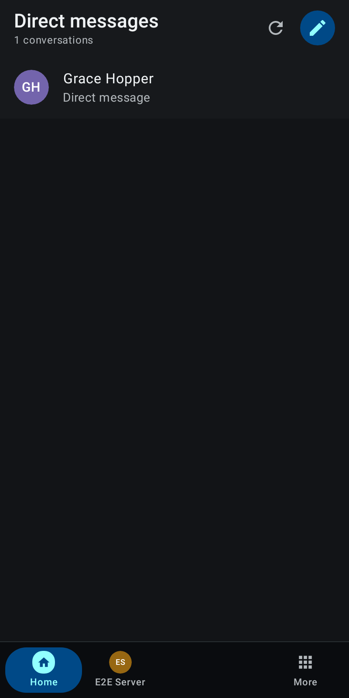
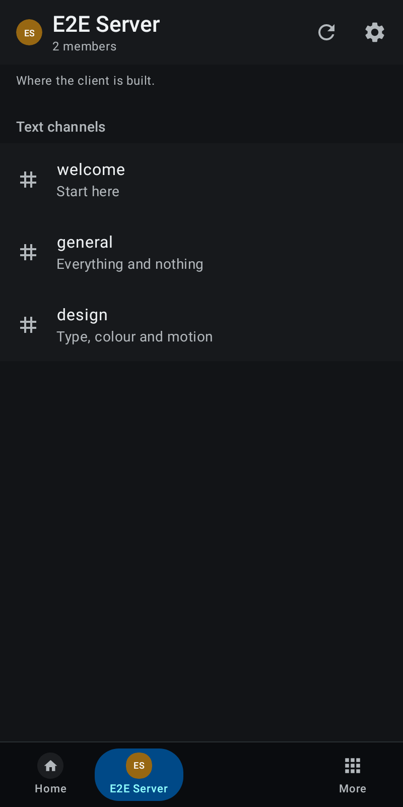
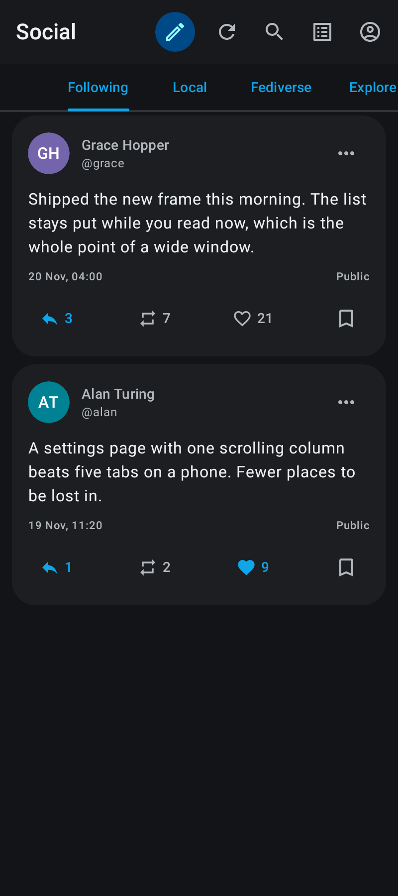
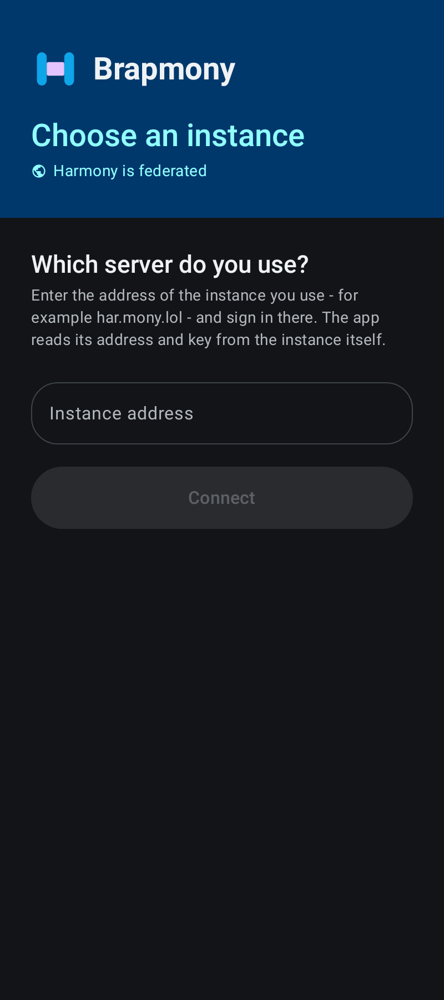
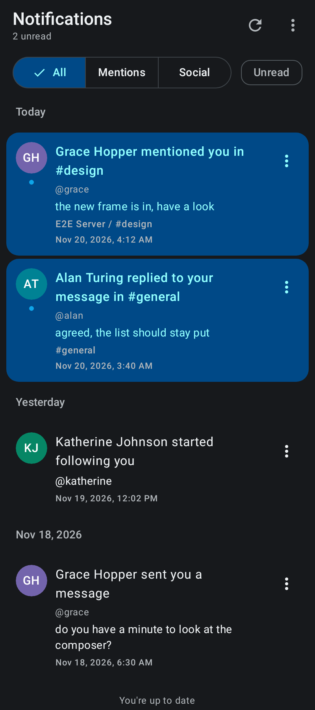
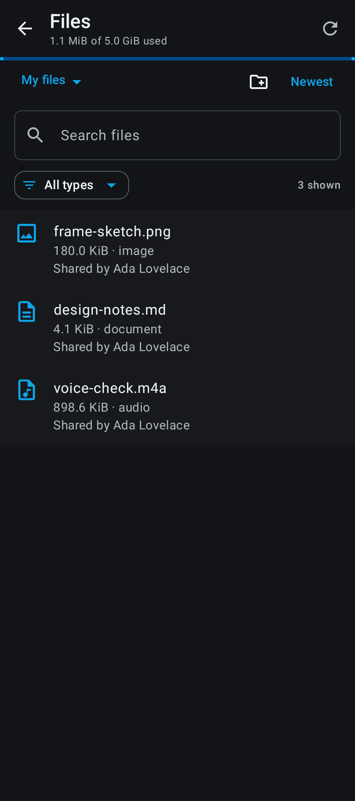
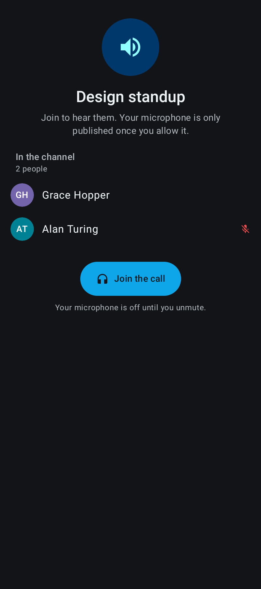
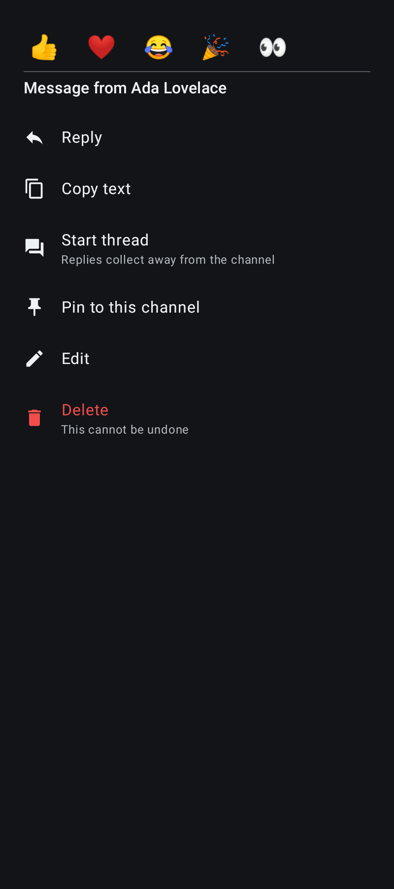
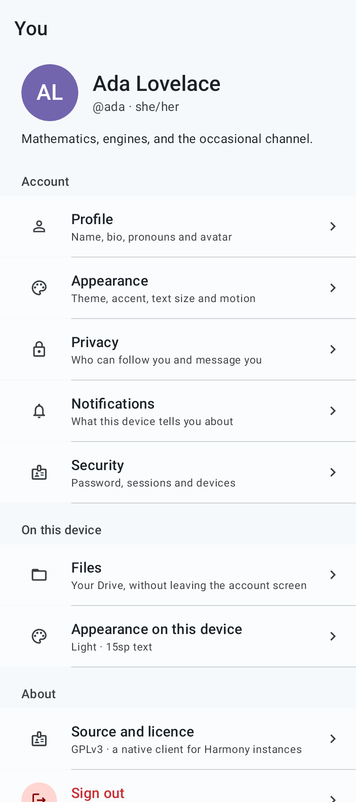
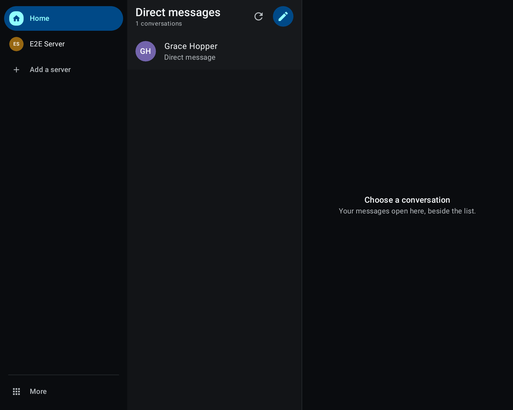

[](LICENSE)

# Brapmony

A native Android client for [Harmony](https://mony.lol): Kotlin and Jetpack Compose, talking
straight to your instance. Messages, servers, social, files, notifications and voice calls, all
drawn by the app.

**[Download the APK](https://github.com/WWPOL/harmony-android/releases/download/android-rolling-main/Brapmony-latest.apk)**
· [Releases](https://github.com/WWPOL/harmony-android/releases)
· [What is not finished yet](docs/parity-audit.md)

<p align="center">
  
  
  
</p>
<p align="center"><sub>Direct messages · a server's channels · the social feed</sub></p>

## Install

**[Brapmony-latest.apk](https://github.com/WWPOL/harmony-android/releases/download/android-rolling-main/Brapmony-latest.apk)**

1. Open it on the phone or tablet and tap the downloaded file.
2. Allow the install when Android asks. The APK is test-signed, so Play Protect may warn.
3. On first launch, enter your instance's address and sign in.

Over a cable:

```sh
adb install -r Brapmony-latest.apk
```

Android 8.0 (API 26) or newer. A signature mismatch means an older build signed with a
different key: uninstall it once.

Each build also keeps its own file name, so it stays downloadable after later pushes. Names,
keys and checksums: [docs/builds.md](docs/builds.md).

## What it does

- Direct messages, servers, channels and threads, paged.
- Messages with mentions, custom and unicode emoji, images, links, attachments and stickers,
  plus reactions, replies, edits, deletes and pins.
- Server management: channels, roles, members, invites and bans.
- A social feed — following, local and the fediverse — with profiles, follow and block lists,
  and posting.
- Drive: your files and the ones shared with you, with owners and quotas.
- Notifications: a local inbox filtered by kind, and taps that open the screen they name.
- Voice and video channels over LiveKit.
- Your account's own look: theme, accent colour, density and text size.

## Screenshots

The app's own render tests, with fixture data: JVM captures, not device photos. More in
[docs/evidence/](docs/evidence/).

<p align="center">
  
  
  
</p>
<p align="center"><sub>Connecting to an instance · notifications · Drive</sub></p>

<p align="center">
  
  
  
</p>
<p align="center"><sub>Joining a voice channel · message actions · the account screen in the light theme</sub></p>

<p align="center">
  
</p>
<p align="center"><sub>On a tablet: the servers as a rail beside the conversation</sub></p>

## Status

Work in progress: no end-to-end encryption or key recovery, no push notifications, and several
media and administration flows are missing. Not a drop-in replacement for the official client.
[docs/parity-audit.md](docs/parity-audit.md) has the gaps;
[docs/parity-matrix.md](docs/parity-matrix.md) tracks each screen.

Try it with a throwaway account.

## Build

JDK 21 and the Android command-line tools:

```sh
sdkmanager 'platform-tools' 'platforms;android-37.0' 'build-tools;37.0.0'
export ANDROID_HOME=/path/to/android-sdk
export JAVA_HOME=/path/to/jdk21

./gradlew :app:assembleDebug :app:testDebugUnitTest :app:lintDebug
```

The debug APK lands in `app/build/outputs/apk/debug/app-debug.apk`. AGP 9.5.1 supplies Kotlin,
so there is no `org.jetbrains.kotlin.android` plugin; the wrapper pins Gradle 9.9.1 and its
SHA-256.

Package `io.github.wwpol.brapmony`, compiled and targeted at SDK 37. Signing keys, SDK paths
and generated APKs stay out of Git: a release build uses a keystore from outside the tree, or
the test key.

## Test

JVM only, no device:

```sh
./gradlew :app:testDebugUnitTest :app:lintDebug
```

Some suites draw real composables through Robolectric, so a screen's pixels are compared
without an emulator. Anything needing a real screen runs on an emulator, never on a phone in
use.

Release tooling and the documentation's links, which need Node 24:

```sh
npm ci
npm test
```

## Run it

`demo.sh` builds, installs on an attached emulator and opens:

```sh
export ANDROID_HOME=/path/to/android-sdk
./demo.sh
```

The build points at an instance on the host gateway (`http://10.0.2.2:54480`; override with
`NATIVE_INSTANCE_URL` and `NATIVE_ANON_KEY`). Unset, it starts on the instance picker.

`doctor.sh` repairs a launch that aborts before any app code runs — the platform failing to
mount the app's device-protected data — without losing data:

```sh
./doctor.sh --serial emulator-5554
./doctor.sh --serial emulator-5554 --repair --apk app/build/outputs/apk/debug/app-debug.apk
```

`upgrade-test.sh` installs two builds one over the other and checks the data survived. Signing
configurations: [docs/builds.md](docs/builds.md#signing).

## Documentation

- [Design](docs/design.md)
- [Builds](docs/builds.md)
- [Verification](docs/verification.md)
- [Parity audit](docs/parity-audit.md)
- [Parity matrix](docs/parity-matrix.md)
- [Message content](docs/message-content.md)
- [Evidence](docs/evidence/)

## Contributing

Bugs, features and pull requests: [CONTRIBUTING.md](CONTRIBUTING.md). Security reports go to
[SECURITY.md](SECURITY.md), not a public issue.

## License

Copyright (C) 2024-present the WWPOL contributors. Free software under the
[GNU General Public License, version 3 or later](LICENSE); no additional terms.

AndroidX, Kotlin, OkHttp, Coil and LiveKit are Apache 2.0; see [COPYRIGHT](COPYRIGHT).
